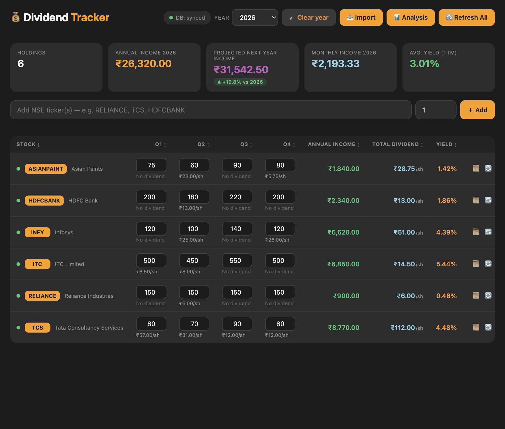

# NSE Dividend Tracker

[](https://github.com/gyaneshgithub/nse-dividend-tracker/actions/workflows/ci.yml)

A local-first dividend income tracker for Indian (NSE) stocks. It fetches
dividend history, stores the quantity you held in each quarter, and calculates
annual and monthly income per stock, per quarter, and per year.

Everything stays on your machine: the portfolio lives in an embedded ChromaDB
database, with a human-readable JSON mirror for backup. No account, cloud
service, or API key is required.



*Screenshot uses a demo portfolio with fictional quantities. No real holdings
are included in this repository.*

**Version:** 1.1.0

## Features

- **Live NSE dividend history** from stockanalysis.com, cached locally.
- **Guided first run** — an empty-state panel explains how to add a ticker,
  where dividend data comes from, and that everything is stored locally, with
  one-click examples.
- **Actionable fetch errors** — network, rate-limit, missing-history and
  ticker-format failures explain what happened, offer Retry, and can copy a
  debug report.
- **Small-screen friendly** — the table scrolls horizontally with a sticky
  header and pinned stock column, and controls reflow for narrow layouts.
- **Quarterly quantities** so income follows the shares you actually held in
  each quarter, not just today's holding.
- **Next-year income scenarios** — a conservative (average quantity), base
  (peak quantity) and growth (dividend CAGR, capped at ±15%) projection, shown
  on the dashboard and in Analysis and Insight.
- **Dividend growth columns** — per-stock **DPS YoY** change and a five-year
  **DPS CAGR** with a sparkline, so cuts and compounding are visible at a
  glance.
- **Financial-year view** — filter by India's April–March FY (FY 2026-27) or by
  calendar year, with a monthly cashflow breakdown in Analysis.
- **Automatic year rollover** — a new calendar year appears on 1 January with
  blank quantities; earlier years are preserved.
- **Bulk import** from a spreadsheet or CSV: downloadable template, ticker plus Q1–Q4 quantities.
- **Income analysis** by year, stock, and quarter, including monthly averages
  and a year-on-year income bridge (quantity, dividend and composition).
- **Rolling 12-month cashflow** — conservative / base / growth scenarios in
  Analysis, Briefing, and `GET /api/forecast`; optional stress compare (base vs
  conservative and −10% qty/DPS shocks).
- **Portfolio briefing** — a read-only task list built from local data:
  missing quantities, failed or stale fetches, dividend cuts, concentration and
  scenario spread, reconcile gaps, refresh-diff alerts, YoY income attribution,
  cashflow stress warnings, export/FY tax and autofill hints, with one-click
  actions.
- **Portfolio insight** — a read-only popup that scores dividend health,
  explains concentration and cuts in plain language, and charts income by year
  and by holding. Includes a **Yield vs own history** component once five
  refresh snapshots exist. Computed on demand from local data; nothing is stored.
- **Semantic search** over indexed dividend payouts using ChromaDB.
- **Multi-window safe** — every write bumps a revision; stale browser windows
  cannot overwrite newer edits or resurrect a deleted stock.
- **Local-first storage** in ChromaDB, mirrored to `data/portfolio.json`.
- **Cross-platform** launchers for macOS, Linux, and Windows.
- **No bundled portfolio** — a fresh clone starts with an empty tracker.

## Quick start

**Requirements:** Python 3.11, 3.12, or 3.13, and an internet connection for
dividend data and the first dependency install.

### macOS / Linux

```bash
git clone https://github.com/gyaneshgithub/nse-dividend-tracker.git
cd nse-dividend-tracker
./start.sh
```

### Windows

```bat
git clone https://github.com/gyaneshgithub/nse-dividend-tracker.git
cd nse-dividend-tracker
start.bat
```

The first run creates `.venv`, installs the pinned dependencies, and starts the
server. Later runs reuse the environment. Open:

**http://localhost:8901/Dividend%20tracker**

You can also run `python run.py` on any platform.

> First install downloads ChromaDB and its dependencies, so it can take a few
> minutes. See [docs/SETUP.md](docs/SETUP.md) for manual setup and
> troubleshooting.

## Documentation

| Guide | What it covers |
| --- | --- |
| [Setup](docs/SETUP.md) | Install, configure, verify, update, and troubleshoot |
| [User guide](docs/USER_GUIDE.md) | Add stocks, enter quantities, import, analyze, delete |
| [ChromaDB](docs/CHROMADB.md) | Embedded database, paths, backup, restore, reset |
| [Architecture](docs/ARCHITECTURE.md) | Components, data model, API, concurrency |
| [Contributing](CONTRIBUTING.md) | Development setup, tests, privacy rules |

## How it works

1. Add one or more NSE tickers. The app fetches the company name, price, and
   dividend history.
2. Enter the quantity held in each quarter. Income for a payout is
   `dividend per share × quantity in that payout's quarter`.
3. ChromaDB stores each holding and an indexed payout record. A JSON mirror is
   written to `data/portfolio.json` after every change.
4. The browser polls a revision counter and merges changes from other tabs.
5. Analysis, insight and search read from the same local database.

The app uses **embedded ChromaDB** — no separate database server is needed.
See [docs/CHROMADB.md](docs/CHROMADB.md) for details.

## Configuration

Copy `.env.example` to `.env` to change defaults. The app works without a
`.env` file.

| Variable | Default | Purpose |
| --- | --- | --- |
| `HOST` | `127.0.0.1` | Bind address. Use `0.0.0.0` only on a trusted network. |
| `PORT` | `8901` | HTTP port. |
| `DIVIDEND_DB_DIR` | `./chroma_db` | ChromaDB directory. Relative paths resolve from the project root. |
| `DIVIDEND_DATA_DIR` | `./data` | JSON backup directory. |
| `DIVIDEND_CACHE_TTL` | `21600` | Upstream dividend cache lifetime in seconds. |
| `ANONYMIZED_TELEMETRY` | `False` | ChromaDB telemetry opt-out. |

Command-line overrides:

```bash
python run.py --host 127.0.0.1 --port 9000
python run.py --no-venv          # use the current Python (CI, Docker)
python run.py --skip-install     # never run pip
```

## Your data

The repository deliberately contains **no portfolio data**.

- `data/portfolio.json` — JSON mirror of your holdings.
- `chroma_db/` — embedded ChromaDB files.
- `.env` — optional local configuration.

All three are excluded by `.gitignore`. Keep your own backups of `data/` and
`chroma_db/`; they are not in version control.

To verify that nothing private is tracked before pushing:

```bash
python scripts/check_repo.py
```

## Development

```bash
python -m venv .venv
source .venv/bin/activate          # Windows: .venv\Scripts\activate
python -m pip install -r requirements.txt -r requirements-dev.txt
python -m pytest
python -m ruff check .
```

Useful checks:

```bash
python scripts/check_setup.py   # dependencies, paths, ChromaDB self-test
python scripts/smoke_test.py    # end-to-end API test on temporary storage
python scripts/check_repo.py    # privacy / packaging audit
python scripts/preflight.py     # the full gate (see below)
python scripts/check_ci.py      # latest CI run on the current branch must be green
```

The full preflight gate runs, in order: lint, tests, smoke test, repository
audit, documentation check, CI status.

### Pre-commit and pre-push checks

`scripts/install_hooks.py` points Git at the tracked hooks in `.githooks/`:

```bash
python scripts/install_hooks.py
```

After that, `git commit` runs lint plus the test suite, and `git push` also
runs the smoke test, the repository privacy audit, the documentation check and
the CI status check. A failing check blocks the operation. Use `python
scripts/preflight.py` to run the same gate by hand, or `git commit --no-verify` /
`git push --no-verify` to bypass it in an emergency. Hooks are local
configuration: each clone must install them once.

CI runs the test suite on Linux (Python 3.11–3.13), Windows, and macOS. See
[.github/workflows/ci.yml](.github/workflows/ci.yml).

## Docker (optional)

```bash
docker compose up --build
```

Open <http://localhost:8901/Dividend%20tracker>. The compose file bind-mounts
`./data` and `./chroma_db`, so the container uses the same local storage as a
native run. Do not expose the port to the public internet.

## Project structure

```text
.
├── server.py              Flask app: guards, headers, errors, startup
├── routes/                Flask blueprints by area (pages, portfolio, dividends, ...)
├── db.py                  ChromaDB storage, merging, tombstones, analysis
├── insight.py             Read-only portfolio scoring and narrative
├── coach.py               Read-only portfolio briefing and coach tasks (API)
├── agent.py               Portfolio agents (import, reconcile, alerts, attribution, stress)
├── forecast.py            Forward cashflow scenarios, autofill, stress metrics
├── market.py              NSE dividend fetch, parse, cache
├── run.py                 Universal launcher (creates .venv on first run)
├── start.sh / start.bat   Platform wrappers
├── templates/index.html   Page shell (initial state injected)
├── static/app.css         Dashboard styles
├── static/app.js          Dashboard behaviour (vanilla JS)
├── scripts/               Setup, smoke, and repository audits
├── tests/                 pytest suite
├── docs/                  Setup, user, ChromaDB, and architecture guides
├── Dockerfile
├── docker-compose.yml
└── AGENTS.md              Instructions for AI coding assistants
```

## Using an AI coding assistant

This project is assistant-agnostic. [`AGENTS.md`](AGENTS.md) is the canonical
instruction file; small pointer files exist for tools that look for their own
conventions (`CLAUDE.md`, `GEMINI.md`, `.cursorrules`, `.windsurfrules`, and
`.github/copilot-instructions.md`). Any assistant that can read files and run
commands can work on the project.

## Disclaimer

This is a personal bookkeeping tool, not investment advice. Dividend data comes
from a third-party website and may be delayed, incomplete, or wrong. Always
verify figures with official company filings and your broker. The author is not
liable for financial decisions made using this software.

## License

[MIT](LICENSE) © 2026 Gyanesh Maurya
